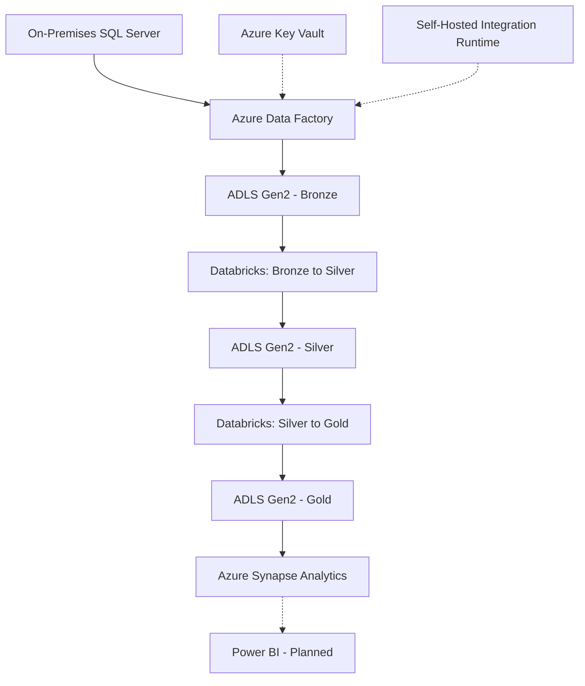

---

## 📌 Project Overview

This project demonstrates an end-to-end Azure Data Engineering solution that ingests data from an on-premises SQL Server database, processes it through a Medallion Architecture, and prepares it for analytics.

Azure Data Factory orchestrates data ingestion, Azure Data Lake Storage Gen2 stores data across Bronze, Silver, and Gold layers, Azure Databricks performs data transformations, and Azure Synapse Analytics provides SQL-based access to curated data.

## 🏗️ Architecture

